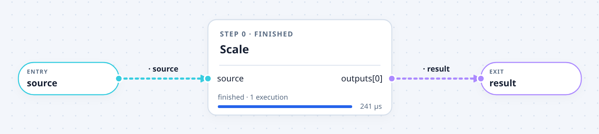
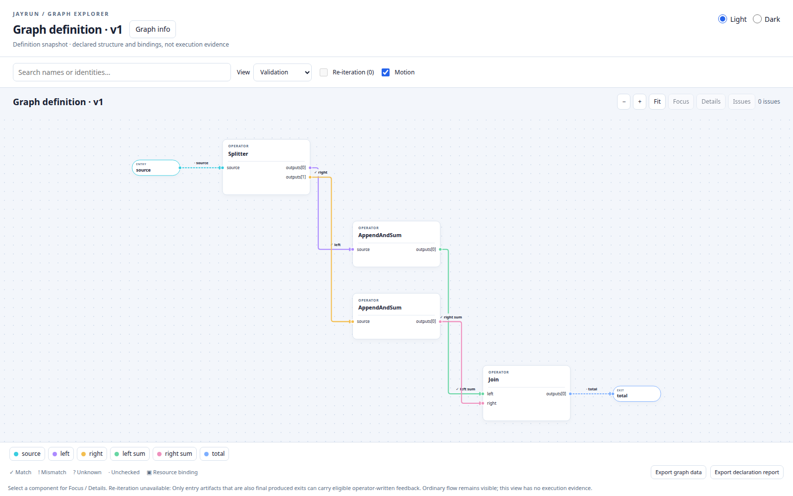
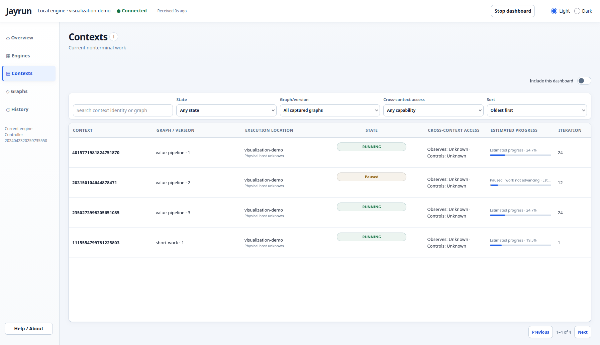

# Jayrun

**Build, run, and inspect Python computation graphs with reusable resources and a live dashboard.**

Jayrun is a Python execution framework for pipelines, iterative experiments and application services. Define each step with a synchronous or asynchronous Python method. Jayrun passes artifact values between steps and manages the lifetimes of intermediate results and shared resources.

[](https://pypi.org/project/jayrun/)
[](https://jayrun.readthedocs.io/en/latest/)
[](https://www.python.org/)
[](https://github.com/jayrun-project/jayrun/actions/workflows/ci.yml)
[](https://github.com/jayrun-project/jayrun/blob/main/LICENSE)

[Quick start](#quick-start) · [Documentation](https://jayrun.readthedocs.io/en/latest/) · [Tutorials](#tutorials) · [API reference](https://jayrun.readthedocs.io/en/latest/reference/imports.html) · [0.3.4 release notes](https://github.com/jayrun-project/jayrun/releases/tag/v0.3.4)

## Quick start

Install Jayrun with Python 3.11 or later.

```bash
python -m pip install jayrun
```

[](https://jayrun.readthedocs.io/en/latest/_static/first_run.html)

Input **7**, factor **3**, result **21**. [Explore this completed run](https://jayrun.readthedocs.io/en/latest/_static/first_run.html).

Save this program as `first_graph.py` and run `python first_graph.py`. It reproduces the graph above and prints `21`.

```python
from jayrun import (
    Artifact, ArtifactContext,
    ArtifactField, ArtifactFlow,
    BaseOperator, ConfigContext,
    ConfigField, Engine, GraphDefinition,
)
from jayrun.context import ContextState


class Scale(BaseOperator):
    def __init__(self, *, source, outputs):
        super().__init__()
        self.source = ArtifactField()
        self.factor = ConfigField(value_type=int)
        self.outputs = (ArtifactField(),)

    def execute(self):
        value = self.source.value
        result = value * self.factor.value
        self.context.record("scaled", result)
        return result


source = Artifact(name="source")
result = Artifact(name="result")
scale = Scale(
    source=source, outputs=(result,)
)
flow = ArtifactFlow(
    scale, artifact=source
)
graph = GraphDefinition(
    flow, entry_flows=flow
)
graph.confirm()

with Engine() as engine:
    run = engine.submit(
        graph,
        ArtifactContext({source: 7}),
        ConfigContext({scale.factor: 3}),
    )
    run.wait(timeout=10)
    if run.state is not ContextState.FINISHED:
        failure = run.report.data.failure
        raise RuntimeError(str(failure))
    print(run.artifact(result).value)  # 21
```

Each submission returns a `ContextRun`. Once it finalizes, check its outcome before reading the result. The [first graph walkthrough](https://jayrun.readthedocs.io/en/latest/start/first-graph.html) explains field binding, reads the recorded value and visualizes the run.

The core runtime requires `packaging`. Install `jayrun[yaml]` for YAML configuration. Individual applications can add libraries such as PyTorch.

## What Jayrun does

- **Reuse expensive resources.** Share models, calibration data and clients across compatible runs, with managed acquisition and teardown.
- **Release intermediate data automatically.** Let Jayrun release consumed artifact values when execution no longer needs them. Retention policies and application references determine what stays alive.
- **Inspect and control execution.** Visualize graphs before running them, follow live work in the dashboard, and inspect captured results, timings and records afterward.

Declare a graph once, then submit it with different inputs and configuration. Graphs can include branches, conditional routes and iteration. They can also act as observers or controllers for other work—the dashboard itself is built as a graph.

See [the overview](https://jayrun.readthedocs.io/en/latest/start/overview.html) for applications and [data and lifetimes](https://jayrun.readthedocs.io/en/latest/start/data-and-lifetimes.html) for how artifacts, configuration and resources fit together.

## Inspect your graphs and runs

Once you have a graph, save its structure with `graph.plot.save("graph.html")`. After execution, save the completed run with `run.plot.save("run.html")` to explore captured outcomes, timings, records and reports. Both create interactive HTML viewers that open in a browser.

[](https://jayrun.readthedocs.io/en/latest/guides/visualization/graphs.html)

*A split-and-join graph with two processing branches. Click to explore the interactive declaration.*

For live work, the dashboard lets you follow running contexts and find recent completions.

[](https://jayrun.readthedocs.io/en/latest/guides/visualization/dashboard.html)

[Explore the dashboard](https://jayrun.readthedocs.io/en/latest/guides/visualization/dashboard.html) or [build a monitoring graph with a Controller](https://jayrun.readthedocs.io/en/latest/guides/runtime/controller.html). The [visualization and reporting guide](https://jayrun.readthedocs.io/en/latest/guides/evidence/plots.html) also covers declarations, registries and completed runs.

To keep diagnostic history beyond an Engine session, pass `Database("execution.sqlite")` from `jayrun.persistence` to `Engine(database=...)`. The Engine owns the database lifecycle. After computation finishes, call `engine.database.flush()` to check that pending history was stored successfully. The [Persistence and Database guide](https://jayrun.readthedocs.io/en/latest/guides/evidence/persistence.html) shows how to write history and read it after the Engine closes. Stored history is separate from application checkpoints and arbitrary artifact storage.

## Tutorials

Each tutorial includes a walkthrough, Python source and a notebook. All seven have a small offline CPU example.

- [Build and validate](https://jayrun.readthedocs.io/en/latest/tutorials/build-and-validate-graph.html) — properties, diagnostics and corrected execution.
  [Python](https://github.com/jayrun-project/jayrun/blob/main/tutorials/build_graph.py) · [Notebook](https://github.com/jayrun-project/jayrun/blob/main/tutorials/01_build_graph.ipynb)
- [Image service](https://jayrun.readthedocs.io/en/latest/tutorials/denoise-images-with-fastapi.html) — async service, shared client and routing.
  [Python](https://github.com/jayrun-project/jayrun/blob/main/tutorials/denoise_images.py) · [Notebook](https://github.com/jayrun-project/jayrun/blob/main/tutorials/02_denoise_images.ipynb)
- [Shared model inference](https://jayrun.readthedocs.io/en/latest/tutorials/mnist-inference-and-training.html#share-a-read-only-model-for-inference) — read-only model reuse and placement.
  [Python](https://github.com/jayrun-project/jayrun/blob/main/tutorials/mnist_inference.py) · [Notebook](https://github.com/jayrun-project/jayrun/blob/main/tutorials/03_mnist_inference.ipynb)
- [Supervised training](https://jayrun.readthedocs.io/en/latest/tutorials/mnist-inference-and-training.html#supervise-replace-and-promote) — iteration, mutable state and scoped supervision.
  [Python](https://github.com/jayrun-project/jayrun/blob/main/tutorials/mnist_training.py) · [Notebook](https://github.com/jayrun-project/jayrun/blob/main/tutorials/04_mnist_training.ipynb)
- [Document service](https://jayrun.readthedocs.io/en/latest/tutorials/document-ingestion.html) — long-running jobs and transactional publication.
  [Python](https://github.com/jayrun-project/jayrun/blob/main/tutorials/document_ingestion.py) · [Notebook](https://github.com/jayrun-project/jayrun/blob/main/tutorials/05_document_ingestion.ipynb)
- [Adapter checkpointing](https://jayrun.readthedocs.io/en/latest/tutorials/checkpointed-adapter-finetuning.html) — model/optimizer/RNG checkpoints.
  [Python](https://github.com/jayrun-project/jayrun/blob/main/tutorials/adapter_finetuning.py) · [Notebook](https://github.com/jayrun-project/jayrun/blob/main/tutorials/06_adapter_finetuning.ipynb)
- [Scientific campaign](https://jayrun.readthedocs.io/en/latest/tutorials/adaptive-scientific-calibration.html) — adaptive control and reproducibility.
  [Python](https://github.com/jayrun-project/jayrun/blob/main/tutorials/heat_calibration.py) · [Notebook](https://github.com/jayrun-project/jayrun/blob/main/tutorials/07_heat_calibration.ipynb)

The tutorial sources and notebooks live in the [GitHub tutorials directory](https://github.com/jayrun-project/jayrun/tree/main/tutorials); they are not included in `pip install jayrun`. Start with the [tutorial setup guide](https://jayrun.readthedocs.io/en/latest/tutorials/index.html) to get the repository, install lesson dependencies and choose a CPU or optional GPU/model workload. For a specific task, follow the guides on [graph construction](https://jayrun.readthedocs.io/en/latest/guides/workflow/index.html), [resources](https://jayrun.readthedocs.io/en/latest/guides/graphs/resources.html), [component interfaces](https://jayrun.readthedocs.io/en/latest/guides/components/index.html) or [application integration](https://jayrun.readthedocs.io/en/latest/guides/integration/index.html).

## Community

Have a question or a workflow to share? Join [GitHub Discussions](https://github.com/jayrun-project/jayrun/discussions). Report bugs and request features through [GitHub Issues](https://github.com/jayrun-project/jayrun/issues); for bugs, include a small reproducible example and your Python and Jayrun versions.

You can also help by reporting confusing examples, suggesting documentation improvements or sharing how you use Jayrun. The [documentation sources](https://github.com/jayrun-project/jayrun/blob/main/docs/index.md) are included in this repository.

## Scope and project status

Jayrun manages graph execution and ownership. Applications supply network transport, authentication, external side effects and checkpoint contents. Placement accounts for declared capacity rather than allocating devices, and cleanup releases framework references rather than guaranteeing an immediate drop in process memory. See [supported behavior and limitations](https://jayrun.readthedocs.io/en/latest/reference/limits.html).

Jayrun provides a tested foundation for graph execution, with ongoing improvements to reliability, usability and documentation. Use imports from `jayrun` and its [documented public modules](https://jayrun.readthedocs.io/en/latest/reference/imports.html); `jayrun.core` and `jayrun.engine` are implementation details.

## License

[Apache License 2.0](https://github.com/jayrun-project/jayrun/blob/main/LICENSE). Copyright 2026 Masoud Yavari.
